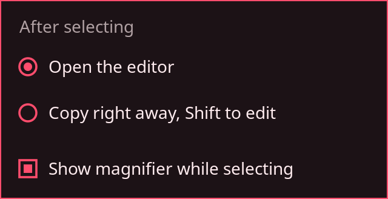

# Annotating

The toolbar appears next to a selection. It sits below the selection if there is room, then above it, then inside it. On a selection that spans monitors, it goes on the monitor holding most of the selection.

Hover over a button for half a second to see its name.

## Tools

| Tool                                  | What it does                                                                                          |
| ------------------------------------- | ----------------------------------------------------------------------------------------------------- |
| **Move and resize selection**         | The default. Shows the handles, so you can [adjust the selection](selecting.md#adjusting-a-selection) |
| **Arrow**                             | Drag from the tail to the point                                                                       |
| **Rectangle**                         | Drag from corner to corner to draw an outline                                                         |
| **Freehand**                          | Draw by dragging                                                                                      |
| **Highlighter**                       | A wide translucent stroke                                                                             |
| **Text**                              | Click to place it, then type                                                                          |
| **Black bar**, **Blur**, **Pixelate** | See [Redacting](redacting.md)                                                                         |
| **Undo**, **Redo**                    | Step through your changes                                                                             |
| **Save**                              | See [Copying and saving](copying-and-saving.md)                                                       |
| **Settings**                          | Opens the [settings panel](#settings)                                                                 |

Drawing only starts inside the selection. To change the selection again, click **Move and resize selection** to get the handles back.

Annotations stay where you drew them on the frozen screen. Moving the selection reframes around them, and only the part inside the selection ends up in the image.

All annotations use the theme's annotation color, which you can change in the [configuration](../reference/configuration.md#colors).

## Text

Click where the text should start, then type.

| Key                      | While typing                                             |
| ------------------------ | -------------------------------------------------------- |
| ++enter++                | Finishes the text. Press it again to copy the screenshot |
| ++esc++                  | Discards this text and keeps the screenshot open         |
| ++backspace++            | Deletes the last character                               |
| ++ctrl+c++ or ++ctrl+s++ | Finishes the text and copies or saves right away         |

Clicking elsewhere or switching tools also finishes the text.

!!! warning "Dead keys and input methods"

    The text tool reads plain key presses. Dead-key accents and input methods are not supported yet.

## Undo and redo

++ctrl+z++ removes the last annotation or redaction, and ++ctrl+y++ or ++ctrl+shift+z++ brings it back. Undo while typing discards only the text in progress.

Drawing something new clears the redo history. Changes to the selection itself are not part of undo.

## Settings

The last toolbar button opens the settings panel.

**After selecting** decides what happens when you finish a new selection:

- **Open the editor** is the default. The selection stays on screen for adjusting and annotating.
- **Copy right away, Shift to edit** copies as soon as you release the mouse, or click a window or monitor. Hold ++shift++ as you release to open the editor instead.

**Show magnifier while selecting** turns the [magnifier](selecting.md#the-magnifier) on or off.

Both are remembered between runs in the [config file](../reference/configuration.md).
