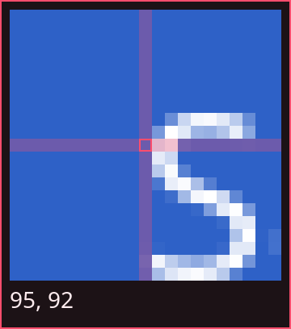

# Selecting

When cot opens, the screen is frozen and dimmed. There are three ways to choose what to keep.

| To select       | Do this                               |
| --------------- | ------------------------------------- |
| A region        | Drag across it                        |
| A window        | Hover so it lights up, then click     |
| A whole monitor | Hold ++ctrl++ and click               |
| Every monitor   | Press ++enter++ with nothing selected |

## Regions

Drag from one corner to the opposite corner, in any direction. A selection can cross from one monitor to another, including rotated ones. The label beside it shows the size of the final image in pixels.

Dragging over a window still draws a free selection. Only a click snaps to the window.

## Windows

Before you have selected anything, the window under the cursor is highlighted. Click to select it. The selection then behaves like any other, so you can resize or annotate it.

Only windows on visible workspaces can be selected. A window that hangs over the edge of its monitor is cut to that monitor.

!!! note "Overlapping windows"

    Hyprland does not report exact stacking order. cot works it out from special workspaces, fullscreen state, floating state and recent focus. With several overlapping floating windows the highlight can pick the wrong one. Drag a region if that happens.

Clicking empty desktop selects nothing. Window snapping needs Hyprland. On other compositors, dragging still works.

## Monitors

Holding ++ctrl++ switches the highlight to the monitor under the cursor. ++ctrl++ + click selects it.

## Adjusting a selection

Once a selection exists, it stays on screen with eight handles.

- Drag a corner or edge to resize. Dragging past the opposite edge flips the selection.
- Drag inside to move it. It stops at the edge of the screen area.
- Drag outside to replace it with a new selection.
- ++ctrl++ + click or ++ctrl++ + drag replaces it, even from inside it.

A plain click outside does nothing, so a stray click can't lose your selection.

Selections reach the exact edge of a monitor, so dragging to the side of the screen includes the last row or column of pixels.

## The magnifier

While you draw or resize a selection, a box beside the cursor shows the frozen pixels at 8× zoom. The exact pixel under the cursor is outlined, and its coordinates are shown underneath.

- It appears only once you have actually started dragging, so it does not flash during a click.
- It stays hidden while you move a selection.
- It flips away from screen edges and never covers the point you are aiming at.
- It shows the original screenshot, without annotations or redactions.
- Coordinates can be negative on a monitor placed left of or above your layout's origin.

To turn it off, use the [settings panel](annotating.md#settings) or set [`magnifier`](../reference/configuration.md#magnifier).

## Cancelling

Press ++esc++ or right-click to close cot without keeping anything.
